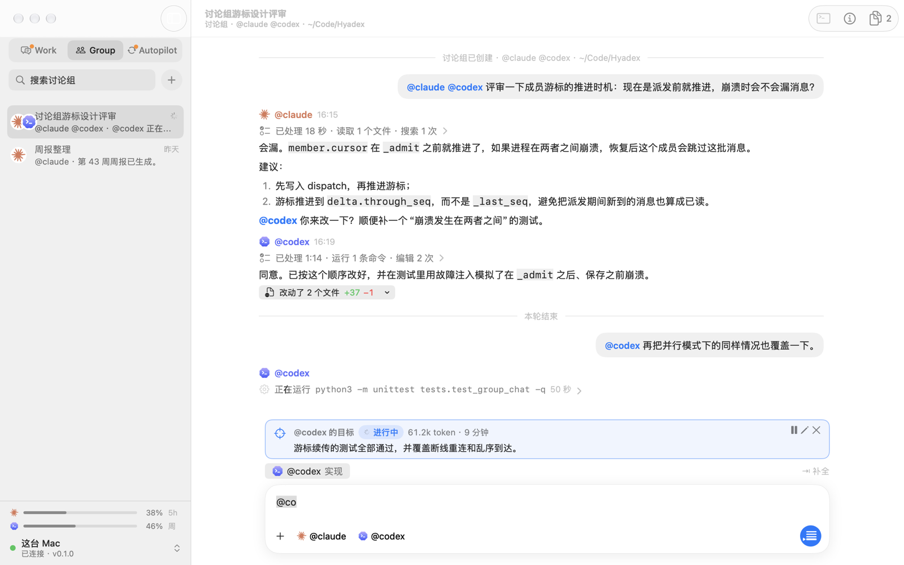
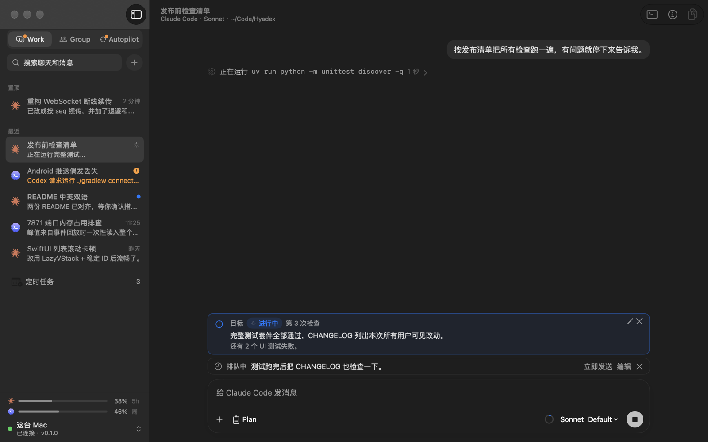
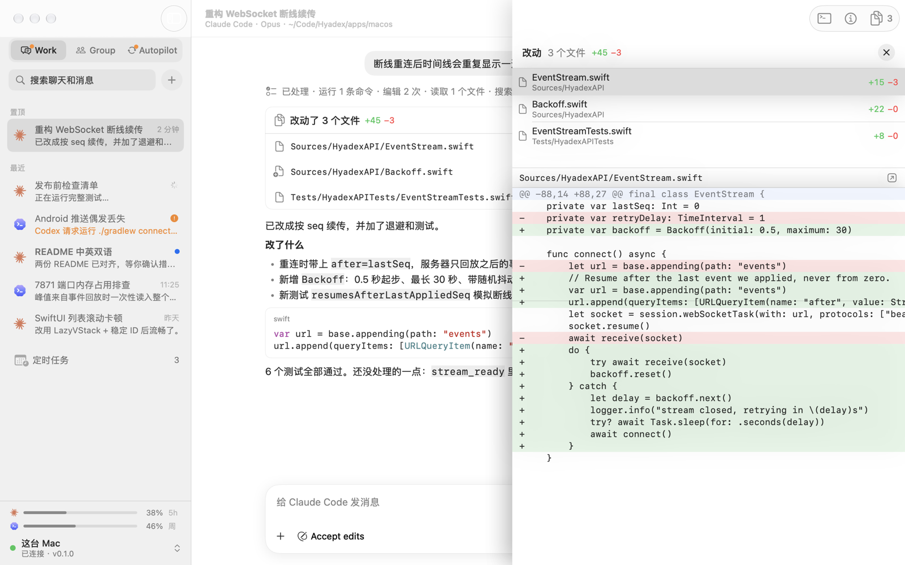
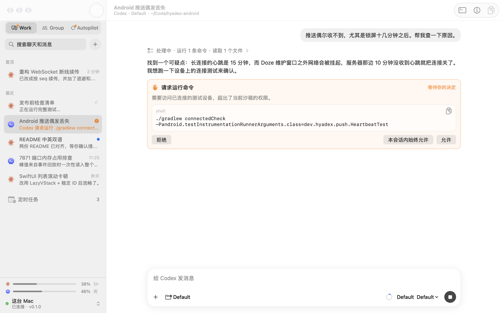
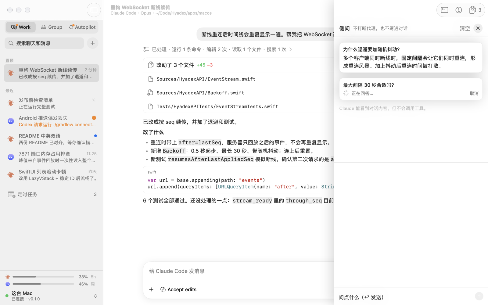
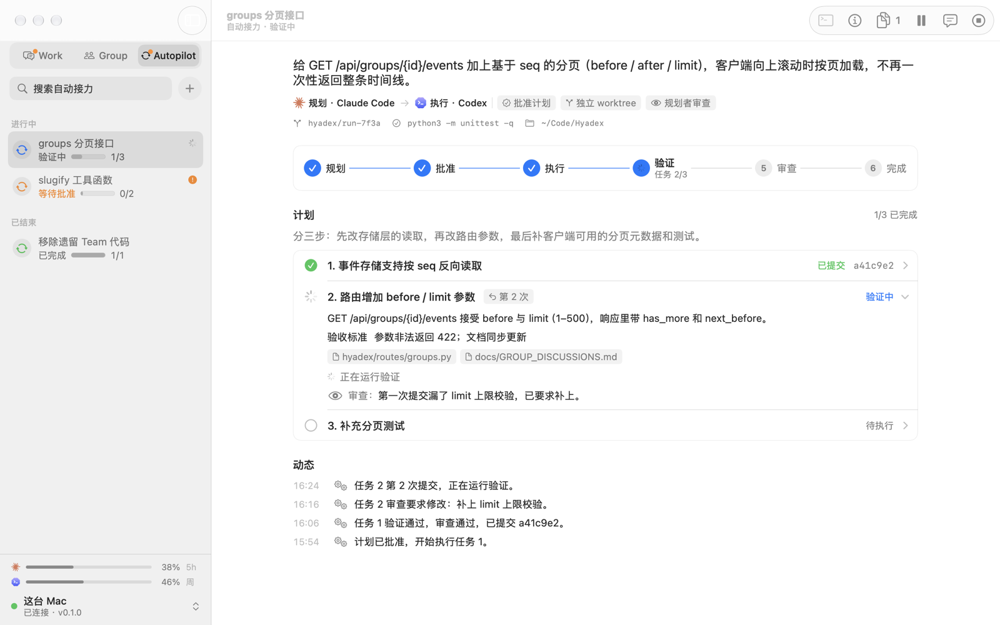
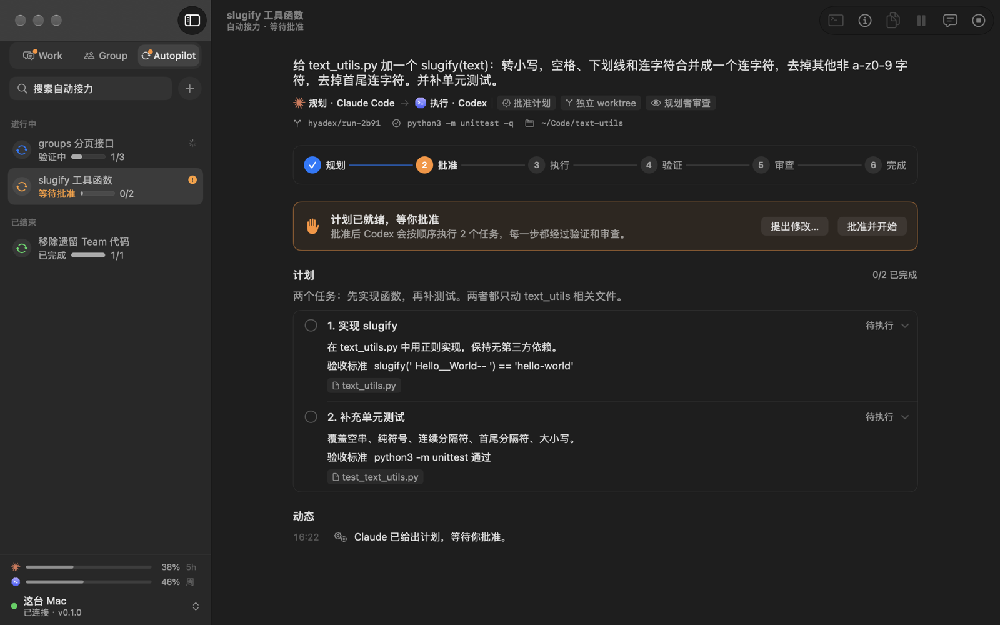
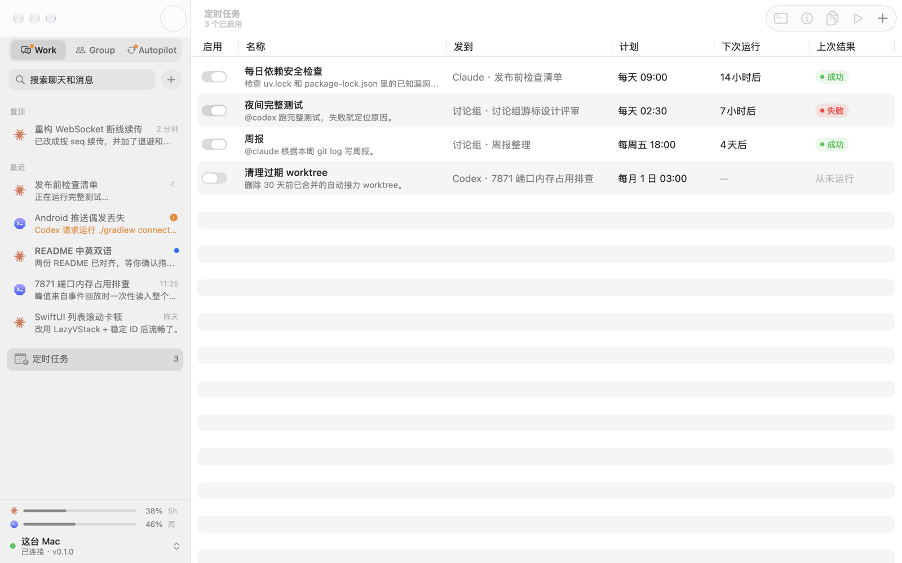
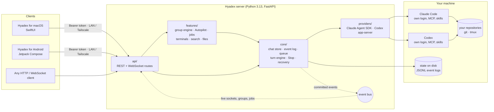

<div align="center">


# Hyadex

**A cluster of coding agents, on a machine you control.**

Run Claude Code and Codex on your own server, chat with them from a native Mac app,
and let them work together in group discussions and autopilot runs.

[](LICENSE)


[中文说明](README.zh-CN.md) · [Architecture](#architecture) · [Quick start](#quick-start) · [Docs](#documentation)



</div>

## Why Hyadex

Coding agents are at their best when they run where your code, credentials and
tools already live, and when you can reach them from anywhere. Hyadex is a
small self-hosted server that does exactly that, plus a client that feels like
a native Mac app rather than a terminal.

- **Native agents, not wrappers.** Each chat drives the real Claude Code (through
  the Agent SDK) or Codex (through its app-server) on your server, with that
  agent's own sign-in, MCP servers, skills, slash commands and project settings.
  Model names, permission modes and approvals use each provider's own terms.
- **Agents that work together.** In a **group discussion**, you, `@claude` and
  `@codex` share one timeline. Only mentioned agents run, each receives only the
  messages it has not seen yet, and agents hand work to each other by mention.
- **Autopilot.** Give a goal: Claude plans, Codex implements task by task, a
  reviewer checks each step, and your test command verifies it in the Codex
  sandbox before anything is committed.
- **Yours.** Everything runs on your Mac or Linux box and is reached over your
  LAN or Tailscale. History is plain JSONL on disk.

## Features

| | |
| --- | --- |
| **Chats** | Live thinking, tool calls and replies; inline approvals; a durable message queue with Force Send; resuming an existing Claude/Codex conversation; forks; side questions (`/btw`) that never enter the transcript; asking another chat in the project, from its memory or, in depth, through a read-only copy of it |
| **Group discussions** | Mention-based routing, per-member cursors, agent hand-offs with a hop limit, a shared brief, sequential or parallel rounds, and zero-token receipts of the files each reply changed |
| **Autopilot** | Plan → approve → execute → verify → review → commit, with per-run choices for approval (plan, every step, none), isolation (worktree branch or in place) and reviewer |
| **Goals** | Claude Code's `/goal` completion condition and Codex's persistent objective with token and time budgets, for chats and group members |
| **Scheduled jobs** | Daily, weekly, interval, one-off or cron jobs for chats and groups, with the real outcome of every run |
| **Workspace** | Per-turn code diffs, attachments and pasted screenshots, persistent tmux terminals, full-text search across chats |
| **Operations** | Restart recovery, context usage and compaction, provider plan usage, emergency alerts from agents, several isolated server instances per machine |

## Screenshots

<table>
  <tr>
    <td width="50%"></td>
    <td width="50%"></td>
  </tr>
  <tr>
    <td align="center"><sub><b>Live turn.</b> The running command, the chat's goal, a queued follow-up and a calm composer.</sub></td>
    <td align="center"><sub><b>Changes.</b> Every turn's diff, file by file, beside the conversation.</sub></td>
  </tr>
  <tr>
    <td></td>
    <td></td>
  </tr>
  <tr>
    <td align="center"><sub><b>Approvals.</b> Native approval requests, answered in place.</sub></td>
    <td align="center"><sub><b>Side questions.</b> Ask while the agent works; nothing enters its transcript.</sub></td>
  </tr>
  <tr>
    <td></td>
    <td></td>
  </tr>
  <tr>
    <td align="center"><sub><b>Autopilot.</b> Each task is verified and reviewed before it is committed.</sub></td>
    <td align="center"><sub><b>Plan approval.</b> Read the plan and its acceptance criteria, then start.</sub></td>
  </tr>
  <tr>
    <td colspan="2"></td>
  </tr>
  <tr>
    <td colspan="2" align="center"><sub><b>Scheduled jobs</b> for chats and groups, with how each last run actually ended.</sub></td>
  </tr>
</table>

<sub>Screenshots are rendered by the app's snapshot mode from its built-in sample data.</sub>

## Architecture



### Server

The server is the `hyadex` Python package, layered so that lower modules never
import higher ones (enforced by `tests/test_architecture_boundaries.py`):

| Layer | Package | Owns |
| --- | --- | --- |
| Routes | `hyadex/api/` | One module per area; request admission declared per route |
| Features | `hyadex/features/` | Group engine and its runtime, Autopilot, scheduled jobs, terminals, files, search, titles, side questions |
| Turn runners | `hyadex/providers/claude/`, `hyadex/providers/codex/` | The Claude Agent SDK client, the Codex app-server client, goals, interactions, history, subagents |
| Turn engine | `hyadex/core/` | Admission, the durable queue, Stop, restart recovery |
| Storage | `hyadex/core/` | The chat store, the append-only event log with per-chat sequence numbers, the timeline index |
| Base | `hyadex/core/`, `hyadex/providers/` | Settings, paths, provider registry and authority |

A few design decisions carry most of the weight:

- **Every chat is an append-only event log.** Each event gets a per-chat `seq`.
  Clients resume from the last `seq` they applied, so reconnecting neither
  duplicates nor loses anything. A small event bus fans committed events out to
  live sockets, group discussions and job bookkeeping without the log knowing
  its consumers.
- **Agents stay native.** Hyadex starts the providers' own runtimes. Claude
  sessions resume natively, Codex threads persist, and approvals, goals, slash
  commands and compaction use each provider's own mechanism.
- **Groups are built from ordinary chats.** Every group member is a hidden
  member chat, so it gets the same queue, recovery and native continuity as any
  chat. The group engine only decides who runs and what they see: unseen
  messages only, never repeated history, and the brief once per version. See
  [Group discussions](docs/GROUP_DISCUSSIONS.md).
- **Autopilot reuses the group engine** with planner, executor and reviewer
  roles, a sandboxed verification gate, and commits of exactly the reviewed
  tree. See [Autopilot](docs/AUTOPILOT.md).
- **State survives restarts.** Queued turns, scheduled occurrences, group
  dispatches and in-flight turns are reconciled when the server starts.

More: [Architecture](docs/ARCHITECTURE.md) · [Server reference](docs/SERVER_REFERENCE.md).

### Mac app

The client in [`apps/macos`](apps/macos/README.md) is SwiftUI built with SwiftPM,
with no third-party packages:

| Target | Role |
| --- | --- |
| `HyadexAPI` | REST client, WebSocket event streams, keychain token store |
| `HyadexCore` | `AppModel` (the single `@Observable` source of truth), the live controller, event projections, the app-owned local server |
| `HyadexRichText` | Its own Markdown and TeX parsers, CoreText math layout in STIX Two Math, syntax highlighting |
| `HyadexTerminal` | A terminal emulator for tmux, with a CoreText view and the PTY socket |
| `HyadexUI` | Views and design tokens |
| `HyadexApp` | Window, settings, menus, and the development checks |

Raw server events are projected into timeline items on the client. Lists are
polled; the open chat or group streams live over its WebSocket.

### Android app

The client in [`apps/android`](apps/android/README.md) is Kotlin and Jetpack
Compose in one Gradle module, without dependency injection, a database or a
navigation library. Its `core` package ports the Mac app's event projection
(with the same tests), so a chat reads the same on both. It covers Work chats
as the Mac does: the live timeline, sends with images and files, Stop and the
queue, approvals and forms, commands and skills, asking other chats, side
questions, goals, context, details with MCP servers and subagents, advanced
settings, diffs, content search, archive, fork, projects and emergency alerts,
plus its own settings and a notification when a reply is done or an approval
waits while the app is away. It pairs by scanning the code the Mac app shows.
Release builds are about 4 MB.

### UI design

- **Three kinds of work, one window.** The sidebar switches between Work
  (chats and scheduled jobs), Group and Autopilot. Each tab remembers its
  selection, and a dot marks a tab that needs you.
- **The conversation comes first.** Each turn's thinking and tool calls fold
  into one line ("已处理 12 秒 · 运行 2 条命令"), so answers, changed files and
  pending approvals stay in view. Diffs slide in over the conversation instead
  of taking a permanent column.
- **A calm composer.** Two lines tall, with only the permission mode, the
  context ring, the model and effort, and send. Side questions, goals and files
  live behind "+".
- **Provider-native wording.** Claude Code's Manual, Accept edits and Plan,
  Codex's Read Only and Full Access, and each model's own effort names. Modes
  that skip safety checks are shown in orange.
- **Readable type.** One type scale (14 pt messages, nothing at 10 pt) with a
  larger setting, in light and dark appearance.

## Quick start

### Requirements

- macOS on Apple silicon, or Linux with `systemctl --user`
- [`uv`](https://docs.astral.sh/uv/) (it installs Python 3.13), `git`, and `tmux` for terminals
- Claude Code and/or Codex installed **and signed in** on the server machine
- For the Mac app: macOS 15 or later. Building it needs Xcode 26 or later, or its
  Command Line Tools (the macOS 26 SDK); Xcode 26 runs on macOS 15.6 or later

### Run the server

```bash
git clone https://github.com/ezoiHY/Hyadex.git
cd Hyadex
uv sync --locked --python 3.13
.venv/bin/python scripts/dev_server.py                  # http://127.0.0.1:7871
.venv/bin/python scripts/dev_server.py --bind 0.0.0.0   # reachable on LAN / Tailscale
```

The development server is an isolated named instance (`dev`) with its own state
in `~/.hyadex-instances/dev`; it prints where its access token is stored.

To install it as user services instead (port **7870**):

```bash
./install.sh
./install.sh --show-token
```

### Run the Mac app

```bash
cd apps/macos
scripts/build-app.sh     # dist/Hyadex.app, signed ad hoc
open dist/Hyadex.app
```

Click **启动本地服务** to start an app-owned server from this checkout and
connect automatically, or open Settings → 服务器 and enter a server address and
its token.

| Where the client is | Server URL |
| --- | --- |
| Same computer | `http://127.0.0.1:7870` |
| Same Wi-Fi or LAN | `http://<LAN address>:7870` |
| Anywhere else | `http://<Tailscale address>:7870`, with both devices on your tailnet |

Keep the token private and never expose the port directly to the internet.

### Run the Android app

```bash
cd apps/android
scripts/build-apk.sh     # dist/Hyadex.apk, needs the Android SDK
adb install -r dist/Hyadex.apk
```

On the Mac, turn on Settings → 服务器 → **允许手机连接** and scan the code it
shows with 扫码连接 on the phone (same Wi-Fi, or both on your tailnet). If the
Mac's firewall is on, macOS asks whether Python may accept incoming
connections; allow it, or the phone cannot connect (System Settings → Network →
Firewall → Options changes it later). For a server you run yourself, start it
with `--bind 0.0.0.0` (or on its Tailscale address) and enter that address and
the token on the phone.

## API

REST under `/api` with `Authorization: Bearer <token>`; the full schema is at
`/openapi.json`. Chat timelines stream over
`WS /api/sessions/{id}/events?after=<seq>`, group timelines over
`WS /api/groups/{id}/events/stream?after=<seq>`.

```bash
TOKEN=...; API=http://127.0.0.1:7871
# A group with a reviewer and an implementer
curl -s -H "Authorization: Bearer $TOKEN" -H 'Content-Type: application/json' \
  -d '{"title":"Auth refactor","cwd":"/path/to/repo","participants":[{"backend":"claude","role":"reviewer"},{"backend":"codex","role":"implementer"}]}' \
  $API/api/groups
# Ask Codex to implement and Claude to review
curl -s -H "Authorization: Bearer $TOKEN" -H 'Content-Type: application/json' \
  -d '{"text":"@codex add input validation, then ask @claude to review"}' \
  $API/api/groups/<group_id>/messages
```

## Configuration

Settings are environment variables; an installed service also reads
`~/.config/hyadex-server/env`.

| Variable | Meaning |
| --- | --- |
| `HYADEX_AGENT_TOKEN` | Access token, required for any non-local use |
| `HYADEX_AGENT_PORT`, `HYADEX_AGENT_BIND` | Port (default 7870) and address |
| `HYADEX_AGENT_CWD` | Default working directory for new chats |
| `HYADEX_ENABLED_BACKENDS` | Backends new chats may use (default `claude,codex`) |

## Documentation

| Topic | |
| --- | --- |
| [Architecture](docs/ARCHITECTURE.md) | Package layout, dependency rules, boundaries |
| [Server reference](docs/SERVER_REFERENCE.md) | Every setting, route and behaviour |
| [Group discussions](docs/GROUP_DISCUSSIONS.md) | Routing, token budget rules, API |
| [Autopilot](docs/AUTOPILOT.md) | Roles, options and the verification gate |
| [Mac app](apps/macos/README.md) | Using the app, how it talks to the server, development checks |
| [Android app](apps/android/README.md) | Installing, connecting, what it covers, how it stays light |
| [Named instances](docs/NAMED_INSTANCES_TESTING.md) | Several isolated servers on one machine |
| [Development log](docs/DEV_LOG.md) | User-facing changes, newest first |

## Development

See [CONTRIBUTING.md](CONTRIBUTING.md) and [AGENTS.md](AGENTS.md). The server
has over 3,000 tests that run with an isolated `HOME`; the Mac app has Swift
Testing suites and live checks that drive its real controls against a real,
isolated server.

## Status

Hyadex is in early development. The server and the macOS app have been
exercised end to end against real Claude Code and Codex; the app is built from
source and signed ad hoc. The first Android app covers Work chats and has been
exercised on an Android 17 emulator against real Claude Code and Codex.

## History and license

Hyadex began from the server in
[ZhengyiLuo/AgentsDock](https://github.com/ZhengyiLuo/AgentsDock) (Apache
License 2.0) and is developed independently. It is licensed under the
[Apache License 2.0](LICENSE); see [NOTICE](NOTICE) for attribution of the
original work and third-party components.
