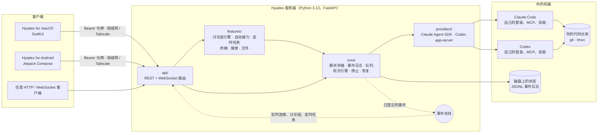

<div align="center">


# Hyadex

**一群编程代理，跑在你自己的机器上。**

在自己的服务器上运行 Claude Code 和 Codex，用原生 Mac 应用和它们对话，
让它们在讨论组和自动接力里一起干活。

[](LICENSE)


[English](README.md) · [架构](#架构) · [快速开始](#快速开始) · [文档](#文档)


</div>

## 为什么做 Hyadex

编程代理最好用的时候，是它跑在你的代码、凭据和工具所在的那台机器上，而你又能随时随地找到它。
Hyadex 是一个很小的自托管服务器，专门做这件事；再配一个用起来像原生 Mac 应用、而不是终端的客户端。

- **原生代理，不是套壳。** 每个聊天直接驱动服务器上真实的 Claude Code（通过 Agent SDK）
  或 Codex（通过 app-server），用的是代理自己的登录、MCP 服务器、技能、斜杠命令和项目配置。
  模型名、权限模式和审批都沿用各家自己的叫法。
- **代理之间能协作。** 在**讨论组**里，你、`@claude` 和 `@codex` 共用一条时间线。
  只有被 @ 的代理才会运行，每个代理只收到自己没看过的新消息，代理之间也能互相 @ 交接工作。
- **自动接力（Autopilot）。** 给一个目标：Claude 做计划，Codex 逐个任务实现，审查者检查每一步，
  你的测试命令在 Codex 沙箱里验证通过后才会提交。
- **一切归你。** 全部运行在你的 Mac 或 Linux 机器上，通过局域网或 Tailscale 访问。
  历史记录就是磁盘上的普通 JSONL 文件。

## 功能

| | |
| --- | --- |
| **聊天** | 实时显示思考、工具调用和回复；就地审批；持久消息队列和立即发送；接着已有的 Claude/Codex 会话继续；分叉；不写进对话的侧问（`/btw`） |
| **讨论组** | 按 @ 路由、每个成员各自的阅读进度、有次数上限的代理接力、共享摘要、依次或同时回答，以及不花 token 的改动回执 |
| **自动接力** | 计划 → 批准 → 执行 → 验证 → 审查 → 提交；每次运行可选审批方式（批准计划、每步批准、不审批）、隔离方式（独立 worktree 分支或原地）和审查者 |
| **目标** | Claude Code 的 `/goal` 完成条件，Codex 带 token 和时间预算的持久目标；聊天和讨论组成员都能用 |
| **定时任务** | 每天、每周、按间隔、一次性或 cron，发给聊天或讨论组，并记录每次运行的真实结果 |
| **工作区** | 每轮的代码 diff、附件和粘贴截图、常驻 tmux 终端、跨聊天全文搜索 |
| **运维** | 重启后恢复、上下文用量与压缩、各家套餐用量、代理发起的紧急提醒、一台机器上多个互相隔离的服务器实例 |

## 截图

<table>
  <tr>
    <td width="50%"></td>
    <td width="50%"></td>
  </tr>
  <tr>
    <td align="center"><sub><b>运行中的一轮。</b>正在执行的命令、这个聊天的目标、排队的追问，以及简洁的输入框。</sub></td>
    <td align="center"><sub><b>改动。</b>每一轮的 diff，按文件展开在对话旁边。</sub></td>
  </tr>
  <tr>
    <td></td>
    <td></td>
  </tr>
  <tr>
    <td align="center"><sub><b>审批。</b>代理原生的审批请求，直接在对话里处理。</sub></td>
    <td align="center"><sub><b>侧问。</b>代理干活时也能提问，不会写进它的对话。</sub></td>
  </tr>
  <tr>
    <td></td>
    <td></td>
  </tr>
  <tr>
    <td align="center"><sub><b>自动接力。</b>每个任务验证并审查通过后才提交。</sub></td>
    <td align="center"><sub><b>批准计划。</b>看过计划和验收标准，再开始。</sub></td>
  </tr>
  <tr>
    <td colspan="2"></td>
  </tr>
  <tr>
    <td colspan="2" align="center"><sub><b>定时任务</b>可以发给聊天或讨论组，并显示上次运行的真实结果。</sub></td>
  </tr>
</table>

<sub>截图由应用的快照模式用内置示例数据渲染。</sub>

## 架构



### 服务器

服务器是 Python 包 `hyadex`，按层组织，低层模块从不导入高层模块
（由 `tests/test_architecture_boundaries.py` 强制检查）：

| 层 | 包 | 负责 |
| --- | --- | --- |
| 路由 | `hyadex/api/` | 每个领域一个模块，每条路由声明自己的准入方式 |
| 功能 | `hyadex/features/` | 讨论组引擎及其运行时、自动接力、定时任务、终端、文件、搜索、标题、侧问 |
| 轮次执行 | `hyadex/providers/claude/`、`hyadex/providers/codex/` | Claude Agent SDK 客户端、Codex app-server 客户端、目标、交互、历史、子代理 |
| 轮次引擎 | `hyadex/core/` | 准入、持久队列、停止、重启恢复 |
| 存储 | `hyadex/core/` | 聊天存储、带每聊天序号的追加式事件日志、时间线索引 |
| 基础 | `hyadex/core/`、`hyadex/providers/` | 配置、路径、代理注册和授权 |

几条关键的设计决定：

- **每个聊天都是一份只追加的事件日志。** 每个事件都有该聊天内的序号 `seq`。
  客户端从自己最后应用的 `seq` 继续，所以断线重连既不会重复也不会丢失。
  一个小的事件总线把已提交的事件分发给实时连接、讨论组和定时任务记账，日志本身不需要知道谁在消费。
- **代理保持原生。** Hyadex 启动的是各家自己的运行时：Claude 会话原生续接，Codex 线程持续存在，
  审批、目标、斜杠命令和上下文压缩都走各家自己的机制。
- **讨论组由普通聊天组成。** 每个成员背后是一个隐藏的成员聊天，所以和普通聊天一样有队列、恢复和原生续接。
  讨论组引擎只决定谁来跑、能看到什么：只发没看过的消息，从不重发历史，共享摘要每个版本只发一次。
  详见[讨论组](docs/GROUP_DISCUSSIONS.md)。
- **自动接力复用讨论组引擎**，分规划、执行、审查三个角色，有沙箱里的验证关卡，并且只提交审查过的那棵树。
  详见[自动接力](docs/AUTOPILOT.md)。
- **状态经得起重启。** 服务器启动时会核对排队中的消息、定时任务的计划时间、讨论组派发和进行中的轮次。

更多：[架构](docs/ARCHITECTURE.md) · [服务器参考](docs/SERVER_REFERENCE.md)。

### Mac 应用

[`apps/macos`](apps/macos/README.md) 里的客户端用 SwiftUI 编写、SwiftPM 构建，不依赖任何第三方包：

| 目标 | 作用 |
| --- | --- |
| `HyadexAPI` | REST 客户端、WebSocket 事件流、钥匙串令牌存储 |
| `HyadexCore` | `AppModel`（唯一的 `@Observable` 状态来源）、实时控制器、事件投影、应用自带的本地服务器 |
| `HyadexRichText` | 自己写的 Markdown 和 TeX 解析器、基于 CoreText 和 STIX Two Math 的公式排版、语法高亮 |
| `HyadexTerminal` | 面向 tmux 的终端模拟器、CoreText 视图和 PTY 连接 |
| `HyadexUI` | 视图和设计常量 |
| `HyadexApp` | 窗口、设置、菜单和开发检查 |

服务器的原始事件在客户端投影成时间线条目。列表靠轮询刷新；当前打开的聊天或讨论组通过 WebSocket 实时更新。

### Android 应用

[`apps/android`](apps/android/README.md) 里的客户端用 Kotlin 和 Jetpack Compose 编写，只有一个 Gradle 模块，
不用依赖注入、数据库或导航库。它的 `core` 包移植了 Mac 应用的事件投影（连同测试），所以同一个聊天在两边显示得一样。
Work 聊天的功能和 Mac 对齐：实时时间线、发送图片和文件、停止和排队、审批和表单、命令和技能、询问其他聊天、侧问、目标、
上下文、详情（MCP 服务器、子代理）、高级设置、diff、内容搜索、归档、分叉、项目和紧急提醒，还有自己的设置页，
以及 app 不在前台时回复完成或有审批在等的通知。扫描 Mac 应用显示的二维码就能配对。release 包约 4 MB。

### 界面设计

- **三类工作，一个窗口。** 侧边栏在 Work（聊天和定时任务）、Group 和 Autopilot 之间切换。
  每个标签记得自己的选择，需要你处理的标签会亮一个小点。
- **对话优先。** 每一轮的思考和工具调用折叠成一行（"已处理 12 秒 · 运行 2 条命令"），
  回答、改动的文件和待审批的请求始终在视野里。diff 从右侧滑出盖在对话上，不常驻占一栏。
- **安静的输入框。** 两行高，底部只有权限模式、上下文圆环、模型和推理强度、发送按钮；
  侧问、目标和文件都收在"+"里。
- **沿用各家原名。** Claude Code 的 Manual、Accept edits、Plan，Codex 的 Read Only、Full Access，
  以及各模型自己的推理强度名。跳过安全检查的模式显示成橙色。
- **字看得清。** 统一的字号体系（消息 14pt，没有 10pt 的字），可以调大一档，支持浅色和深色外观。

## 快速开始

### 环境要求

- Apple 芯片的 macOS，或带 `systemctl --user` 的 Linux
- [`uv`](https://docs.astral.sh/uv/)（会自动装好 Python 3.13）、`git`，终端功能需要 `tmux`
- 服务器上已安装**并登录**了 Claude Code 和/或 Codex
- Mac 应用可以在 macOS 15 或更高版本上运行。构建它需要 Xcode 26 或更高版本，或者对应版本的
  Command Line Tools（要有 macOS 26 SDK）；Xcode 26 本身要求 macOS 15.6 或更高版本

### 运行服务器

```bash
git clone https://github.com/ezoiHY/Hyadex.git
cd Hyadex
uv sync --locked --python 3.13
.venv/bin/python scripts/dev_server.py                  # http://127.0.0.1:7871
.venv/bin/python scripts/dev_server.py --bind 0.0.0.0   # 局域网 / Tailscale 可访问
```

开发服务器是一个独立的命名实例（`dev`），状态存放在 `~/.hyadex-instances/dev`，启动时会打印访问令牌文件的位置。

也可以安装成用户服务（端口 **7870**）：

```bash
./install.sh
./install.sh --show-token
```

### 运行 Mac 应用

```bash
cd apps/macos
scripts/build-app.sh     # 生成 dist/Hyadex.app，临时签名
open dist/Hyadex.app
```

点**启动本地服务**，应用会用当前源码目录启动一个自己管理的服务器并自动连接；
或者在 设置 → 服务器 里填写服务器地址和令牌。

| 客户端在哪里 | 服务器地址 |
| --- | --- |
| 同一台电脑 | `http://127.0.0.1:7870` |
| 同一个 Wi-Fi 或局域网 | `http://<局域网地址>:7870` |
| 其他任何地方 | `http://<Tailscale 地址>:7870`，两台设备都要在同一个 tailnet 里 |

令牌请妥善保管，不要把端口直接暴露到公网。

### 运行 Android 应用

```bash
cd apps/android
scripts/build-apk.sh     # 生成 dist/Hyadex.apk，需要 Android SDK
adb install -r dist/Hyadex.apk
```

在 Mac 上打开 设置 → 服务器 → **允许手机连接**，再用手机上的**扫码连接**扫描它显示的二维码
（两台设备在同一个 Wi-Fi，或都在同一个 tailnet 里）。如果 Mac 开着防火墙，系统会问是否允许 Python 接受传入连接，
要点允许，否则手机连不上；以后可以在 系统设置 → 网络 → 防火墙 → 选项 里修改。
如果服务器是你自己运行的，启动时加上 `--bind 0.0.0.0`（或绑定到它的 Tailscale 地址），再在手机上填写这个地址和令牌。

## API

REST 接口在 `/api` 下，用 `Authorization: Bearer <token>` 认证，完整接口定义在 `/openapi.json`。
聊天时间线通过 `WS /api/sessions/{id}/events?after=<seq>` 推送，讨论组时间线通过
`WS /api/groups/{id}/events/stream?after=<seq>` 推送。

```bash
TOKEN=...; API=http://127.0.0.1:7871
# 建一个讨论组：一位审查者、一位实现者
curl -s -H "Authorization: Bearer $TOKEN" -H 'Content-Type: application/json' \
  -d '{"title":"Auth refactor","cwd":"/path/to/repo","participants":[{"backend":"claude","role":"reviewer"},{"backend":"codex","role":"implementer"}]}' \
  $API/api/groups
# 让 Codex 实现，再请 Claude 审查
curl -s -H "Authorization: Bearer $TOKEN" -H 'Content-Type: application/json' \
  -d '{"text":"@codex add input validation, then ask @claude to review"}' \
  $API/api/groups/<group_id>/messages
```

## 配置

配置都是环境变量；安装成服务时还会读取 `~/.config/hyadex-server/env`。

| 变量 | 含义 |
| --- | --- |
| `HYADEX_AGENT_TOKEN` | 访问令牌，任何非本机使用都必须设置 |
| `HYADEX_AGENT_PORT`、`HYADEX_AGENT_BIND` | 端口（默认 7870）和监听地址 |
| `HYADEX_AGENT_CWD` | 新聊天的默认工作目录 |
| `HYADEX_ENABLED_BACKENDS` | 新聊天可用的代理（默认 `claude,codex`） |

## 文档

| 主题 | |
| --- | --- |
| [架构](docs/ARCHITECTURE.md) | 包结构、依赖规则、边界 |
| [服务器参考](docs/SERVER_REFERENCE.md) | 所有配置、路由和行为 |
| [讨论组](docs/GROUP_DISCUSSIONS.md) | 路由、token 预算规则、API |
| [自动接力](docs/AUTOPILOT.md) | 角色、选项和验证关卡 |
| [Mac 应用](apps/macos/README.md) | 使用方法、和服务器的交互方式、开发检查 |
| [Android 应用](apps/android/README.md) | 安装、连接、覆盖哪些功能、怎样保持轻量 |
| [命名实例](docs/NAMED_INSTANCES_TESTING.md) | 一台机器上运行多个隔离的服务器 |
| [开发日志](docs/DEV_LOG.md) | 面向用户的改动，按时间倒序 |

（各专题文档目前为英文。）

## 开发

见 [CONTRIBUTING.md](CONTRIBUTING.md) 和 [AGENTS.md](AGENTS.md)。服务器有 3,000 多个测试，
都在隔离的 `HOME` 下运行；Mac 应用有 Swift Testing 测试套件，以及在真实隔离服务器上驱动真实控件的界面检查。

## 状态

Hyadex 处于早期开发阶段。服务器和 macOS 应用已经在真实的 Claude Code 和 Codex 上做过端到端验证；
应用目前从源码构建，使用临时签名。第一版 Android 客户端覆盖 Work 聊天，
已经在 Android 17 模拟器上对真实的 Claude Code 和 Codex 做过验证。

## 来历与许可

Hyadex 起源于 [ZhengyiLuo/AgentsDock](https://github.com/ZhengyiLuo/AgentsDock) 的服务器部分
（Apache License 2.0），之后独立开发。本项目采用 [Apache License 2.0](LICENSE) 许可；
原作品和第三方组件的署名见 [NOTICE](NOTICE)。
